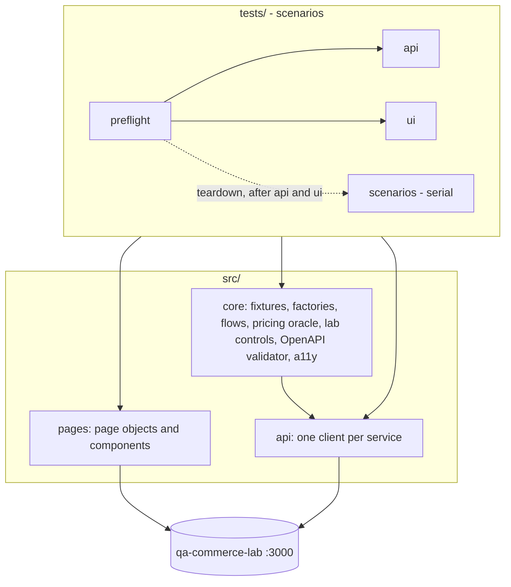

# qa-commerce-lab-tests

[](https://github.com/TomasevicJovan/qa-commerce-lab-tests/actions/workflows/tests.yml)
[](https://tomasevicjovan.github.io/qa-commerce-lab-tests/)

UI, API, contract and accessibility test automation with **Playwright + TypeScript** for [qa-commerce-lab](https://github.com/TomasevicJovan/qa-commerce-lab): a storefront backed by six independent services, an asynchronous checkout over **Apache Kafka**, and switches that inject failures on purpose (declined payments, paused consumers, duplicate events, stale prices, rate limits, unstable locators).

Every push, pull request and nightly run starts the lab in Docker with fresh data, runs all **42 tests** and publishes the [HTML report](https://tomasevicjovan.github.io/qa-commerce-lab-tests/).

## What this suite demonstrates

- **Layered framework.** Tests read as scenarios; page objects and per-service API clients hide the mechanics; a core layer owns fixtures, test data and lab control.
- **API-first test data.** Users, carts and orders are created through the API. The browser is used only for what is being tested.
- **Asynchronous systems.** HTTP 202 is treated as "accepted", never as "paid". Tests poll with deadlines until an order is terminal and verify the event chain, the saga compensation after a failed payment and recovery after a paused consumer.
- **Business rules with an independent oracle.** The documented pricing formula is reimplemented in the tests and compared with the server, including both sides of the free-shipping boundary.
- **Concurrency.** Two customers race for the last unit: exactly one wins, stock never goes negative, the loser is never charged.
- **Idempotency.** Exact replays return the original order with no second charge; a reused key with a different body is rejected.
- **Contract testing.** Responses are validated against the OpenAPI spec served by the running lab, and undocumented status codes fail the test.
- **Accessibility.** axe-core checks WCAG 2.1 A/AA. Known defects are tolerated only for the exact rule and element they affect.
- **Isolation of global state.** Lab switches affect everyone, so the tests that flip them run alone, after everything else (see [Design decisions](#design-decisions)).
- **Stability over retries.** During development the suite was run repeatedly on 4 parallel workers. The two races this exposed (an early click before the app attached its handlers, and parallel tests sharing a product's stock) were fixed at the cause, not hidden with retries.

## Defects found

The suite found four real defects in the lab. Each one is reported as an issue and covered by a test that links it. Until a defect is fixed, the report shows it as a tracked known issue, not a red build. When it is fixed, the test (or the axe annotation) says so.

| Issue | Area | Defect | How the test tracks it |
|---|---|---|---|
| [#1](https://github.com/TomasevicJovan/qa-commerce-lab/issues/1) | UI | Checkout country dropdown is missing Germany (malformed `<option>`) | `test.fail()` with issue annotation |
| [#2](https://github.com/TomasevicJovan/qa-commerce-lab/issues/2) | API contract | `PUT /cart` with an unknown product returns 404 instead of the documented 422 | `test.fail()` with issue annotation |
| [#3](https://github.com/TomasevicJovan/qa-commerce-lab/issues/3) | Accessibility | Secondary text contrast 4.17:1, below the WCAG AA minimum of 4.5:1 | `color-contrast` tolerated on the collection page only |
| [#4](https://github.com/TomasevicJovan/qa-commerce-lab/issues/4) | Accessibility | Bag button shows "Bag 0" but is named "Open shopping bag" (WCAG 2.5.3) | tolerated on `#cart-open` only; the same rule anywhere else fails |

## Coverage

| Area | Tests | Highlights |
|---|---:|---|
| Preflight | 2 | Six services healthy, lab on baseline settings |
| Authentication API | 2 | Full session lifecycle with token revocation; 401/409/422 negatives |
| Cart and ownership API | 3 | Seven kinds of invalid cart rejected with the saved cart kept; other customers get 404 |
| Business rules API | 8 | Pricing oracle (5 cases), idempotent replay and key conflict, last-unit race |
| UI: catalog and authentication | 10 | Pagination, debounced search, filters, sorting, login/registration flows |
| UI: bag, checkout and lab panel | 7 | End-to-end order verified through UI, API and events; discounts and shipping boundary; lab health view |
| Accessibility | 2 | Collection page and checkout dialog, WCAG 2.1 A/AA |
| Lab scenarios (serial) | 8 | Payment decline/timeout compensation, paused inventory, duplicate events, stale price, session expiry, rate limit, dynamic locators |
| **Total** | **42** | |

Tags: `@smoke` (8, the critical path), `@regression`, `@api`, `@a11y`.

## Architecture



```text
src/
  api/          One client per service (auth, catalog, inventory, cart, orders, payments, lab) and response types
  pages/        ShopPage, OrdersPage, LabPage; Header, AuthDialog, BagDialog, CheckoutDialog, Totals components
  core/
    fixtures.ts         workerUser, api, anonApi, createUser, lab, signedInPage
    factories/          Unique users, addresses, checkout bodies, idempotency keys
    flows/              placeOrder, waitForTerminalOrder, ensureStock, quoteServerTotal
    pricing.ts          Independent implementation of the documented pricing rules
    schema-validator.ts OpenAPI response validation (Ajv)
    a11y.ts             axe-core scan with scoped known violations
    lab-controls.ts     Global scenario switches with automatic reset
    test-products.ts    Which test owns which product's stock
    known-issues.ts     Links to tracked defects
tests/
  preflight/    Runs first; if it fails, api and ui are skipped
  api/          Parallel API tests
  ui/           Parallel browser tests (Chromium)
  scenarios/    Tests that flip global lab switches; one at a time, after everything else
```

## Design decisions

**Global lab switches run in a serial teardown project.** A switch such as `paymentMode=decline` would break any checkout that runs at the same moment. These tests live in `tests/scenarios`, and that project is wired as the *teardown* of `preflight`. Playwright therefore starts it only after `api` and `ui` have finished, even if some of them failed, and runs it with one worker. The `lab` fixture restores baseline settings after every test. Teardown projects ignore the CLI `--grep`, so `playwright.config.ts` applies the same filter to them.

**Authentication is injected, not clicked.** Each worker registers one customer through the API. The storefront keeps its token in `sessionStorage`, which `storageState` does not persist, so the `signedInPage` fixture writes it before the app boots. The login UI is still tested directly, starting signed out.

**Stock is a shared, non-renewable resource.** The lab has no restock endpoint. Parallel tests that assert a stock change each own a product (`test-products.ts`), and every purchase first checks availability with an actionable message instead of failing later as a confusing `rejected` order.

**Asking the server for a total without buying.** Checkout rejects a mismatching expected total with `409 Current total is N cents` before saving anything. The pricing tests send a deliberately wrong total to read the server's calculation without consuming stock.

**Waiting on state, not time.** Assertions retry until the expected state appears (`expect`, `expect.poll`). The single fixed wait in the suite proves that something does *not* happen while a consumer is paused, and its comment says why.

**Readable without Cucumber.** Descriptive test names, `test.step()` and tags give business-readable reports without a Gherkin layer to maintain.

## Run locally

Requirements: Node.js 24 and a running [qa-commerce-lab](https://github.com/TomasevicJovan/qa-commerce-lab) on http://localhost:3000 (Docker with Kafka, or `npm start` without Docker).

```sh
npm ci
npx playwright install chromium
npm test
npm run report
```

| Script | Runs |
|---|---|
| `npm test` | Everything: preflight, api and ui in parallel, then the serial scenarios |
| `npm run test:smoke` | The critical path (8 tests) |
| `npm run test:regression` | Everything tagged `@regression` |
| `npm run test:api` | API tests |
| `npm run test:a11y` | Accessibility tests |
| `npm run test:headed` | Everything, with a visible browser |
| `npm run typecheck` | TypeScript check |

Preflight always runs first, so a filtered run also includes its two checks. To run a single file without preflight and scenarios, add `--no-deps`:

```sh
npx playwright test tests/ui/catalog.spec.ts --no-deps
```

Optional settings (base URL, demo account, order timeout) are listed in `.env.example`.

**Stock runs out locally.** A full run consumes seeded stock, and the lab cannot restock. After several runs a test reports which product is missing and how to reset the lab. The last-unit race is skipped unless the data is fresh. CI always starts from fresh data.

```sh
# in the qa-commerce-lab folder
docker compose down --volumes && docker compose up -d --wait   # Docker mode
npm run reset                                                  # Node mode, with the lab stopped
```

## Continuous integration

[`.github/workflows/tests.yml`](.github/workflows/tests.yml) runs on every push to `main`, on pull requests, manually, nightly, and **whenever qa-commerce-lab is pushed**. A lab push sends a `repository_dispatch` event with its commit, so the suite tests exactly that version. The workflow:

1. checks out this repository and the lab;
2. starts the lab with Docker Compose and Kafka, with fresh data;
3. installs Node.js 24 and Chromium, then type-checks and runs the suite;
4. prints the lab logs if anything failed;
5. uploads the HTML report as an artifact and publishes it to [GitHub Pages](https://tomasevicjovan.github.io/qa-commerce-lab-tests/), including when tests fail.

## Limitations

- Lab switches are global, so scenario tests cannot run in parallel against one lab. Parallel scenarios would need one lab instance per worker.
- Automated accessibility checks find only part of the real issues. Keyboard and screen-reader passes are still manual work.
- The UI runs on desktop Chromium only.

## Tech stack

Playwright · TypeScript · Ajv (OpenAPI validation) · axe-core · GitHub Actions · GitHub Pages · Docker Compose · Apache Kafka (in the system under test)
